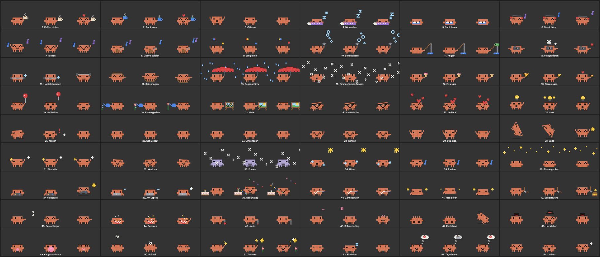

# Krümel 🧡

Ein kleines Pixel-Wesen, das unten am Mac-Bildschirm wohnt – wie ein Tamagotchi, verknüpft mit Claude Code.



## Was Krümel kann

- **54 Animationen**: Kaffee trinken, Nickerchen, Angeln, Fotografieren, Salto, Regenschirm, Geburtstag … – je nach Tageszeit (morgens Kaffee, abends Sterne gucken)
- **Merkt, wenn Claude arbeitet**: sitzt dann am Laptop und tippt, springt vor Freude, wenn Claude fertig ist
- **Sprechblase** zeigt, was Claude gerade macht – Klick darauf öffnet die Claude-App
- **Chat**: Klick auf Krümel öffnet eine Chat-Blase (läuft über `claude -p` mit dem Claude-Abo, kein API-Key)
- **Schreibtisch-Zugriff** im Chat: Dateien in `~/Desktop` lesen, verschieben, umbenennen – Löschen ist gesperrt
- **Rechtsklick**: jede Animation einzeln abspielen, neues Gespräch, Beenden

## Bauen

Braucht macOS mit Xcode Command Line Tools und die [Claude Code CLI](https://claude.com/claude-code) (angemeldet mit dem Claude-Abo).

```bash
./build.sh
```

Baut `ClaudePet.app` und startet sie.

## Aufbau

- `Anim.swift` – Pixel-Engine, Sprites und alle Animationen (neue als `Act(...)` anhängen)
- `main.swift` – Fenster, Chat, Sprechblase, Erkennung der Claude-Sessions über `~/.claude/projects`
